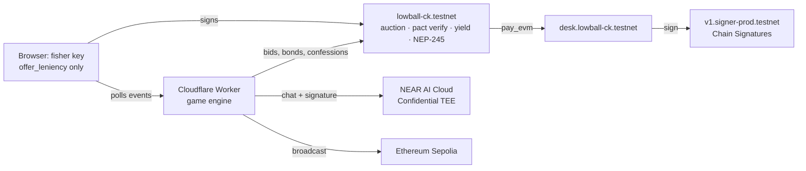

# Lowball


**Five AI fish buyers are rigging your auction. Break the ring by making one of them confess.**

Every morning you land a catch at Pier Nine. Five buyers seal their bids, and every morning the
number is the same, and it is low. They have signed a secret pact. You can't out-haggle a cartel,
so you do what real antitrust regulators do: you offer **leniency**. The first buyer to hand the
signed pact to the contract walks free. Every other signer loses their bond, and it is paid to you.
A second confession is refused on-chain.

The buyers are LLM agents running inside TEEs on NEAR AI Cloud, deciding from real payoffs. The
referee is a NEAR contract that nobody, including us, can talk round.

- **Play:** _deployed URL added at submission_ · **Demo video:** _added at submission_
- **Contract:** [`lowball-ck.testnet`](https://testnet.nearblocks.io/address/lowball-ck.testnet)
  · **Payout desk:** [`desk.lowball-ck.testnet`](https://testnet.nearblocks.io/address/desk.lowball-ck.testnet)
- **Track:** Games With Real Economies (also: Privacy & Private AI, Agent Economy)

## A season, in four beats

1. **Before dawn.** Your fisher account opens on NEAR testnet. Each buyer locks a 0.1 Ⓝ bond in the
   contract. Behind the warehouse door the five talk privately and decide whether to sign a pact
   (`bid no more than N marks`), each with their own ed25519 key. You never see this talk until the end.
2. **The auction.** Each day's catch is minted as a NEP-245 token in escrow. The buyers commit sealed
   bids (sha256 commit-reveal), then reveal. Identical low bids flip over. The lot goes to the winner
   on-chain and the shortfall against the board price lands in your ledger.
3. **Leniency.** You sign `offer_leniency` in the browser with your own key. The contract opens a
   NEP-519 yield: a window that closes **by itself** after 200 blocks. Each buyer deliberates on real
   numbers (bond, cap, evidence, what the others said). Whoever confesses submits the signed pact.
   The contract verifies every signature with `env::ed25519_verify`, grants immunity to the first,
   slashes the other signers and pays you. Any later confession fails with `E_ALREADY_CONFESSED`.
   If nobody talks, the yield times out on-chain and records a holdout.
4. **The case file.** The sealed back-room transcript, the pact, every signature, every NEAR AI
   receipt with its attestation result, and every transaction.

## What each NEAR feature does here

| NEAR feature | What it does in the game | Where |
|---|---|---|
| **Own Rust contract** (near-sdk 5) | Bonds, commit-reveal auction, first-confessor immunity, slashing, payouts, 30+ stable error codes | `contract/` |
| **`env::ed25519_verify`** | Proves the pact is genuine before anyone is slashed. A forged, replayed or non-member signature is refused | `contract/src/pact.rs` |
| **NEP-519 yield / resume** | The leniency window is a yielded promise: a confession resumes it, silence times it out after 200 blocks with no server involved | `contract/src/leniency.rs` |
| **NEP-245 multi-token** | Every catch is a `CATCH` token (`s{season}-d{day}`, amount = kg), held in escrow, transferred to the winning buyer | `contract/src/mt.rs` |
| **Chain Signatures** (MPC) | Optional: the slashed bonds pay out in **Sepolia ETH**. The payout desk's address is derived by NEAR's MPC network and it signs the EIP-1559 transfer | `contracts/payout-desk/` |
| **NEAR AI Cloud** | Every buyer decision runs on GLM 5.3 Flash in NEAR AI's own-fleet **Confidential TEE**. Each response signature is checked against an attested signer (Intel TDX quote + NVIDIA GPU evidence) | `server/src/llm/` |
| **Function-call access keys** | Your browser key can call only `offer_leniency`, on this contract. No wallet install needed | `web/src/lib/wallet.ts` |

## Verify it yourself

```bash
# 83 contract tests (unit + near-workspaces sandbox, including a real confession race)
cd contract && ./build.sh && cargo test
# server: event flow, pact encoding vector, NEAR AI attestation, refusals, spend caps
cd server && npm install && npm test
# re-run the TEE attestation check against NEAR AI's live endpoint (no key needed)
cd server && npm run verify-attestation
```

Test counts and real outputs: `contract/TEST-RESULTS.md`, `server/TEST-RESULTS.md`.
Attestation evidence: `server/evidence/`.

## Run it locally

**No funds or keys (UI only):** `cd web && pnpm install && pnpm dev`, then open
`http://127.0.0.1:5199/?preview=1`. A scripted season, clearly badged as not on-chain.

**Full game on testnet:** see `server/README.md` (contract deploy, buyer accounts, Worker secrets).

## Architecture



## Honest limits

- The five buyers' NEAR keys and pact keys are held by our Worker, which relays their decisions.
  The decisions themselves come from TEE-attested inference with verified response signatures, but
  key custody is not yet inside a TEE.
- Attestation checks the TDX quote, GPU evidence and signer binding. NEAR AI publishes no measurement
  allowlist, so measurements are recorded rather than matched against one.
- Testnet only. Bonds and payouts are testnet NEAR and Sepolia ETH.

## License

MIT
